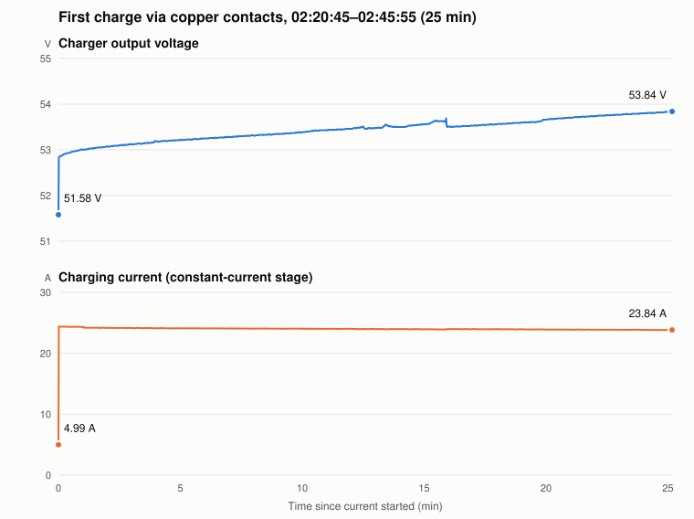

# Results / 結果

## 2026-11-17 First charge through copper contacts / 第一次經銅片充電

**English**
- Charged at constant current for ~25 min (log ends 02:45:55; charging continued a little longer). No faults.
- Current: steady at 23.8–24.4 A (charger CC setting 25 A).
- Charger output voltage: 51.58 V → 53.84 V.
- Charger internal temperature: ~37 °C, no rise (this is *not* the copper contact temperature).
- Positive-contact voltage drop: ≈ 10 mV at ~24 A (multimeter 200 V range, measured on the screws, at the meter's resolution limit) → ≈ 0.41 mΩ including screw contacts.
- Copper contacts felt warm, not hot, after charging (by hand; no thermometer reading yet).
- The ~12 s at the start where the relay was on but the emergency stop was pressed (0 A) is excluded from the plot.

**中文**
- 定電流充電約 25 分鐘（記錄到 02:45:55 為止，之後又多充了一小段），全程無故障。
- 電流：穩定在 23.8～24.4 A（充電器 CC 設定 25 A）。
- 充電器輸出電壓：51.58 V → 53.84 V。
- 充電器內部溫度：約 37 °C，沒有上升（這**不是**銅片溫度）。
- 正極壓降：約 24 A 時 ≈ 10 mV（電表 200 V 檔，量測點在螺絲，接近解析度）→ 含螺絲接觸約 0.41 mΩ。
- 拔開後手摸銅片溫溫的、不燙手（尚未用溫度計量）。
- 一開始約 12 秒急停被壓著（繼電器 ON 但 0 A），這段不畫進圖中。

## Files / 檔案
| File | |
|---|---|
| `first_charge_20261117_021556.csv` | Raw log, 1 Hz: time, voltage, current, charger temp, fault, status / 原始記錄，每秒一筆 |
| `first_charge_20261117.svg` | Plot / 圖 |
| `plot_charge.py` | `python3 plot_charge.py <log.csv> <out.svg>` (no extra packages / 不需額外套件) |
